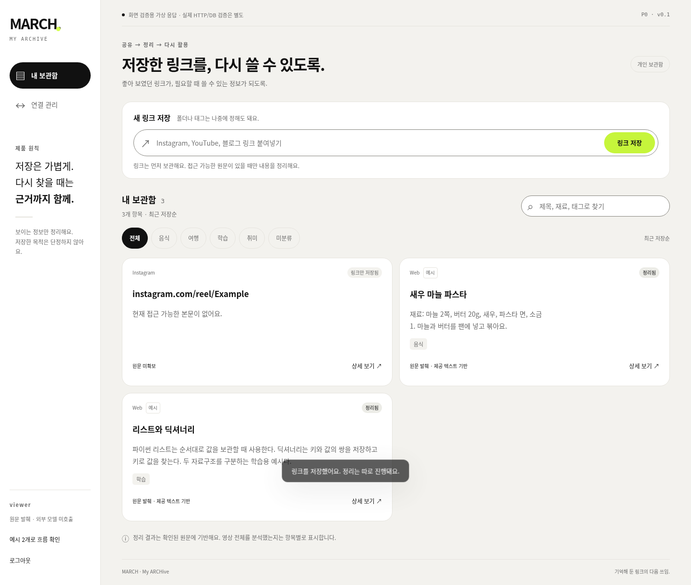

# March - My Archive

**저장한 릴스와 링크를, 필요할 때 다시 쓸 수 있는 개인 보관함.**

Instagram에서 봇으로 공유하거나 웹에 URL을 붙여 넣습니다. MARCH는 링크부터 저장하고, 확보한 설명문이나 원문으로 요약·태그·확인된 정보를 정리합니다. 나중에 키워드로 찾고, 카드에서 정리의 근거를 확인할 수 있습니다.

[제품 기획](https://github.com/march-my-archive/FE/blob/main/docs/PRD.md) · [화면과 디자인](https://github.com/march-my-archive/FE/blob/main/docs/DESIGN.md) · [고민과 결정 기록](https://github.com/march-my-archive/FE/blob/main/docs/DECISIONS.md) · [P2 공유 컬렉션 구상](https://github.com/march-my-archive/FE/blob/main/docs/SHARING.md)

## 저장에서 재검색까지

1. **저장** · 웹 URL 입력 또는 연결된 Instagram 계정에서 공유. 태그와 폴더 지정은 선택입니다.
2. **정리** · 확보한 원문에 근거해 요약합니다. 원문을 확보하지 못하면 `링크만 저장됨`으로 표시합니다.
3. **재검색** · 제목·태그·정리 내용으로 검색하고, 상세에서 근거와 개인 메모를 봅니다.

## 화면

v0.1.0 예시 데이터로 촬영한 보관함입니다. [디자인 문서와 모바일 상세 화면](https://github.com/march-my-archive/FE/blob/main/docs/DESIGN.md)에서 화면별 동작과 이후 변경을 확인할 수 있습니다.

## 저장소

| 저장소 | 책임 |
| --- | --- |
| [BE](https://github.com/march-my-archive/BE) | 인증, Capture API, Instagram 연동, DB, 작업 큐와 비용 원장 |
| [FE](https://github.com/march-my-archive/FE) | 저장·검색·보관함·상세·연결 관리, 기획과 디자인 문서 |
| [AI](https://github.com/march-my-archive/AI) | 원문 구조화, 근거 검증, 모델 어댑터와 품질·비용 비교 |

개발 변경은 `feat/* → dev → main`으로 반영합니다. [개발 흐름](https://github.com/march-my-archive/FE/blob/main/CONTRIBUTING.md)

## 파일럿과 다음 검증

로컬 v0.2 파일럿에서 URL 영속 저장, 원문 기반 정리, 검색, 편집·삭제가 동작합니다. 실제 Meta 계정에서 제3자 릴스 본문과 영상을 확보하는 경로는 검증 대기입니다. **선택 공유와 여행 일행용 공유 컬렉션은 P2 기획 단계**입니다.
